# gcad asset samples

Editable game-asset examples for [Wixely/gcad](https://github.com/Wixely/gcad),
including source geometry, textures and reproducible rendering recipes.

## Missile launcher

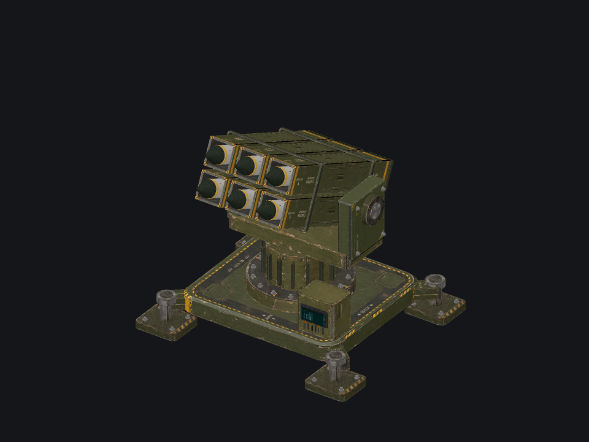

The [missile launcher sample](missile-launcher/README.md) demonstrates unique UV
layouts, painted colour maps, procedural normal maps, sprite relighting and
texture-density normalization. It is a fictional static visual prop.

### Animated turntable


[Open the full looping APNG](missile-launcher/preview/launcher-360.apng) (512 × 512,
120 frames, five seconds). The turntable rotates the model under fixed lighting.

### Around the model

Eight views show the platform, launch tubes, support structure and control box.
Angles are model rotation relative to the render recipe's camera.

| 0° | 45° |
| --- | --- |
| 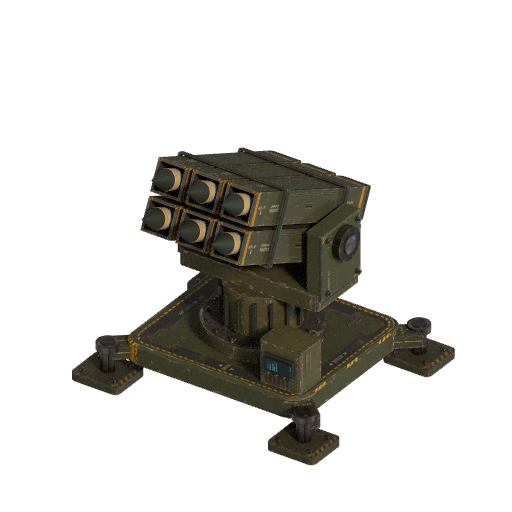 | 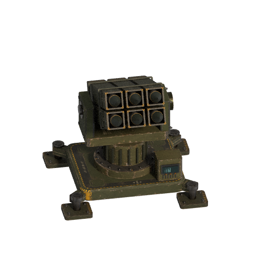 |
| **90°** | **135°** |
| 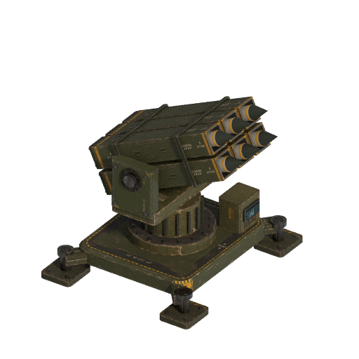 | 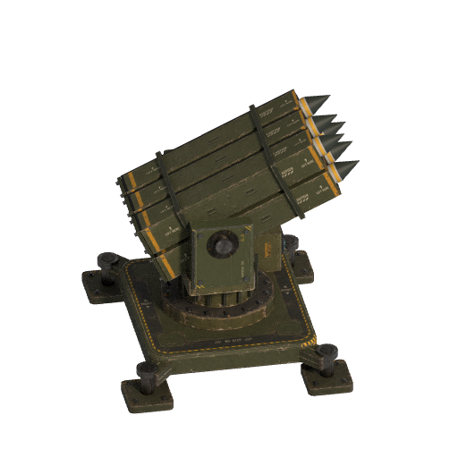 |
| **180°** | **225°** |
| 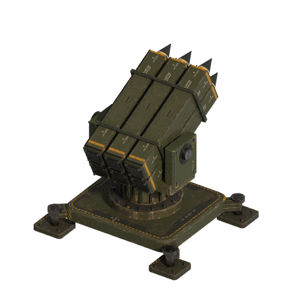 | 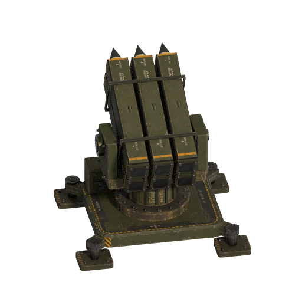 |
| **270°** | **315°** |
| 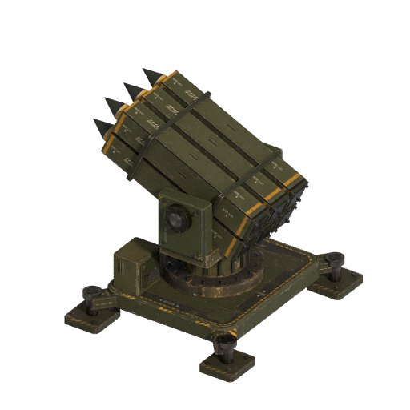 | 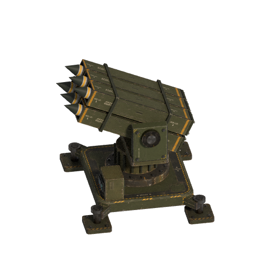 |

### Sprite sheets and relighting

The same eight directions exported as 256 × 256 cells, with transparent
backgrounds. The [render recipe](missile-launcher/relight.sprites.json) produces
the lit sheet and separate albedo and normal sheets for runtime lighting.

**Lit sprites with soft shadows**

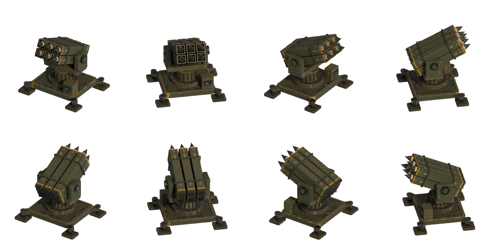

**Albedo — colour without baked lighting**

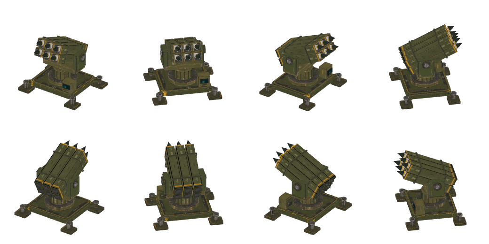

**Normals — surface directions for 2D relighting**

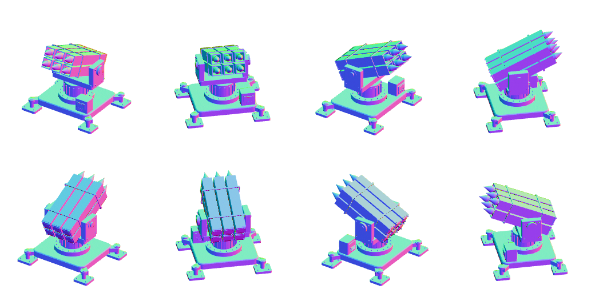

### UVs and painted surface detail

The deck illustrates the texture workflow: labelled UV islands guide painting,
then the colour atlas and procedural normal map wrap onto the geometry.

| Labelled UV layout | Painted colour atlas | Normal map |
| --- | --- | --- |
| 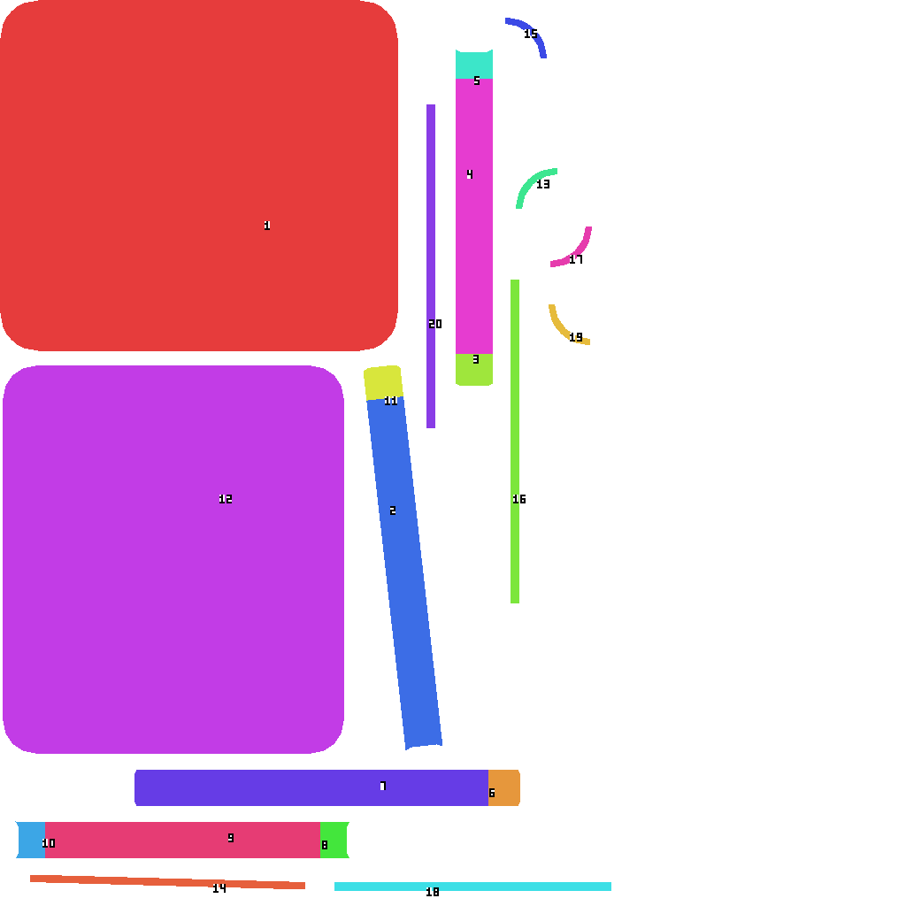 | 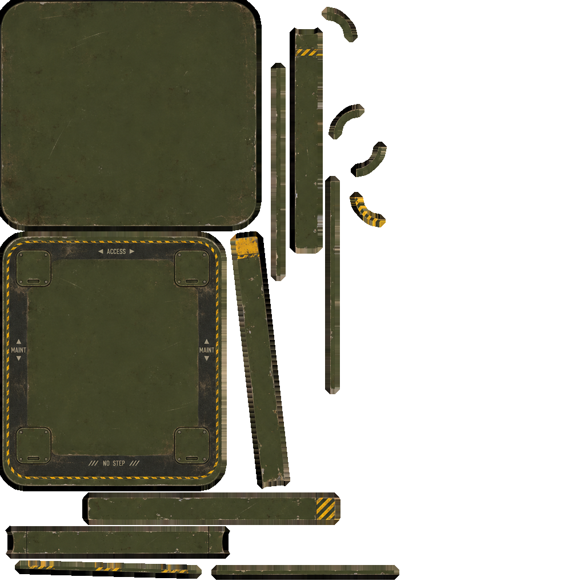 | 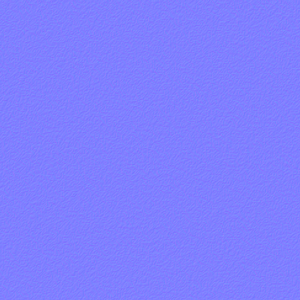 |

### Open and export the sample

Use the `game-assets` branch of gcad, tested at
[`7d5b384`](https://github.com/Wixely/gcad/commit/7d5b384409c2641a7af7d3e4b16defb08333ed21),
built with `cargo build --locked --release --features game-assets`.
Native game-asset builds require a C++ toolchain and libclang. See gcad's
[game-asset documentation](https://github.com/Wixely/gcad/blob/game-assets/docs/game-assets.md).

This repository contains samples, not a copy of the gcad application. Commands
below assume that feature build is available as `gcad` on PATH.

```sh
gcad view missile-launcher/platform.gasset
```

Sample sources, artwork and tooling are distributed under [MIT](LICENSE), to the
extent copyright applies. See [asset provenance](missile-launcher/PROVENANCE.md).
Dependencies retain their own licenses.

Reviewed: 2026-11-02. Windows validation is documented with the sample; Linux and
game-engine import remain untested. Next action (owner: sample consumer): preview
the model and choose the desired export density for the target game.
